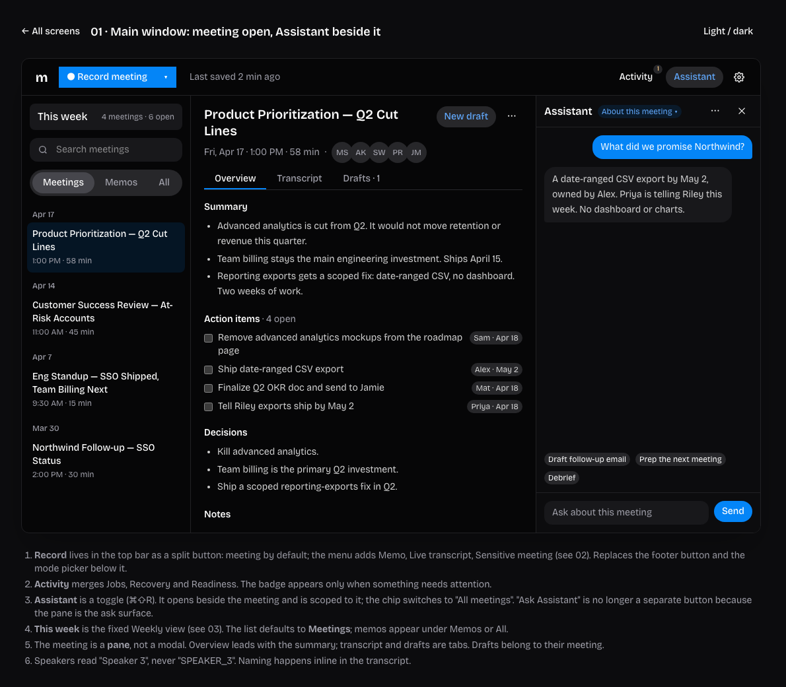
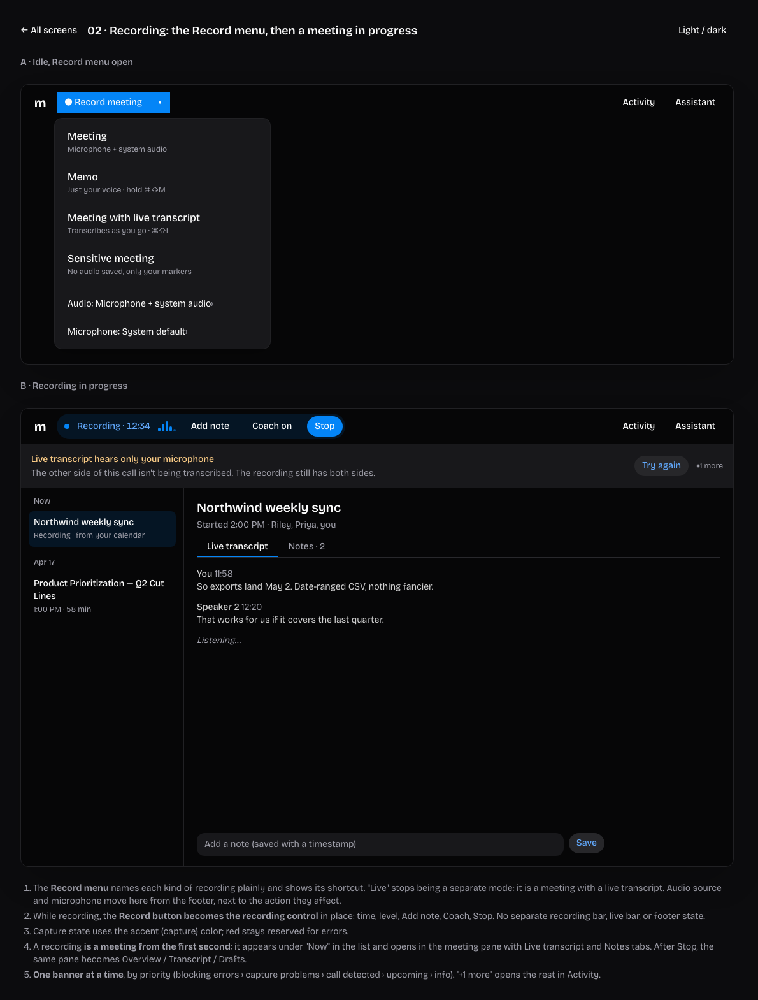
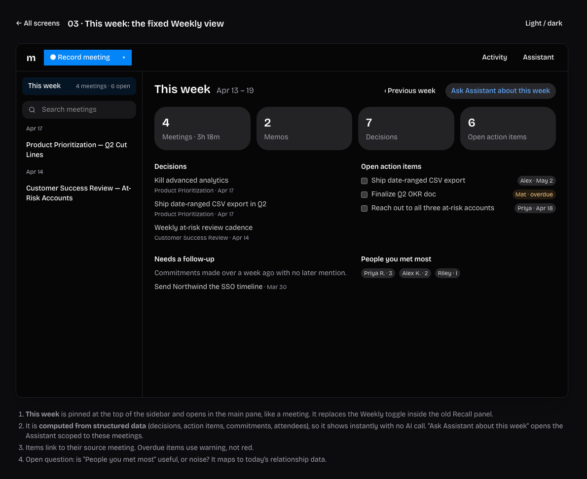
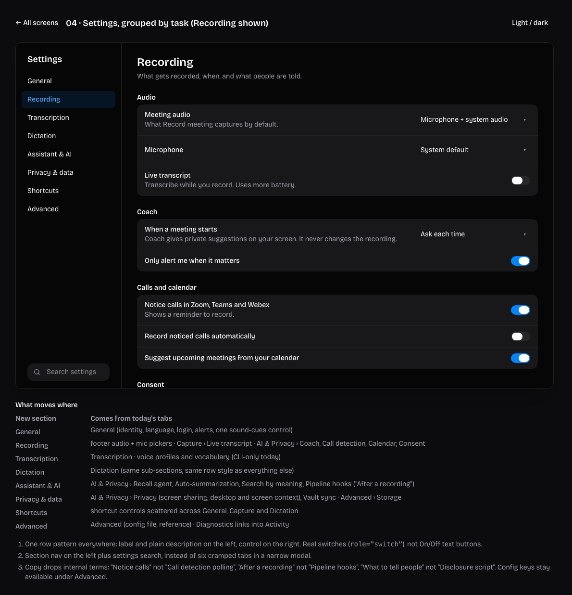
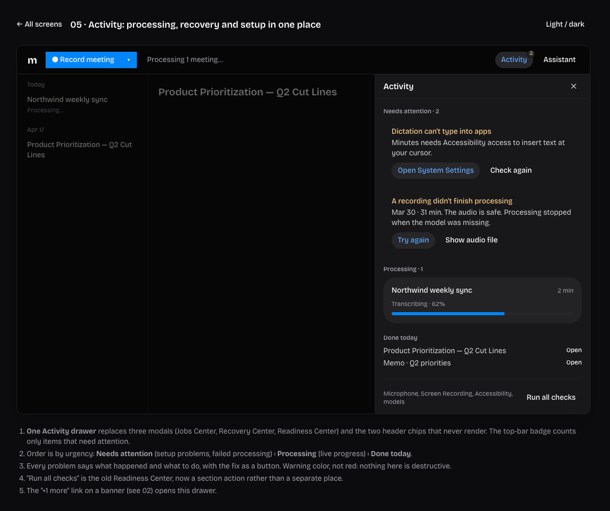
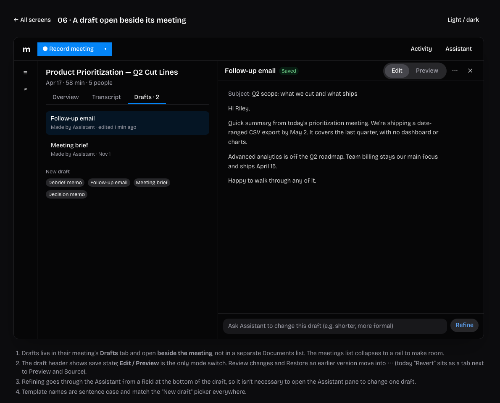
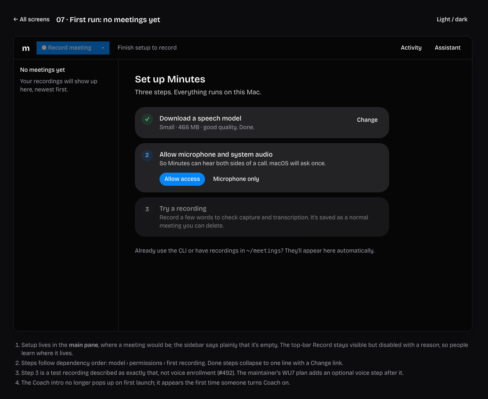
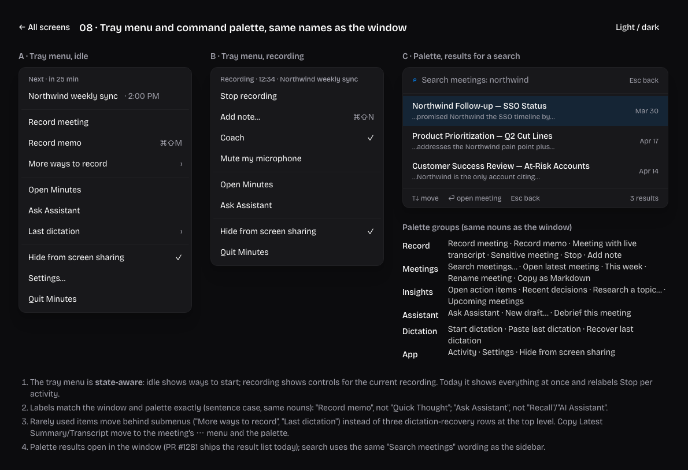

# Minutes IA proposal (draft)

A proposal for reorganizing the desktop app, CLI and MCP around one set of names and two homes: **Meetings** and the **Assistant**. Nothing here is implemented; it's for discussion.

- [00 — Current state, problems and decisions](00-current-state.md)
- [04 — Proposed structure](04-proposed-structure.md)
- Evidence: [01 main window](01-inventory-main-window.md) · [02 CLI, MCP, skills](02-inventory-cli-mcp.md) · [03 tray, menus, palette, windows](03-inventory-desktop-entry-points.md)

## Wireframes

Low-fidelity, at the app's default 1120×720 window. Built with HeroUI styles; the visuals are placeholders, the structure is the point. Open `wireframes/index.html` locally for the interactive versions.

| | |
|---|---|
| **01 · Main window**: meeting as a pane, Assistant beside it, Record in the top bar |  |
| **02 · Recording**: Record menu, in-place recording control, one banner at a time |  |
| **03 · This week**: fixed weekly view from decisions, action items, commitments |  |
| **04 · Settings**: grouped by task, one row pattern, plain language |  |
| **05 · Activity**: processing, recovery and setup checks in one drawer |  |
| **06 · Draft beside its meeting** |  |
| **07 · First run** |  |
| **08 · Tray and palette**: same names as the window |  |
